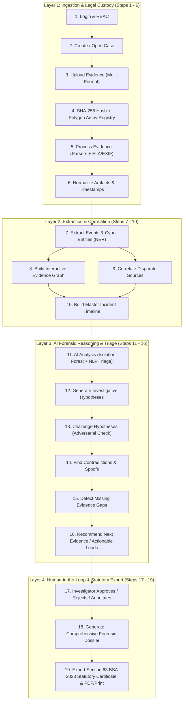

# Implementation Plan: AI-Powered Indigenous Digital Forensics Investigation Framework (DFIR)

Transform the baseline prototype in `C:\My Projects\SUTRAM 2026\Prototype` from a document locker into an active, intelligent **Digital Forensics and Incident Response (DFIR)** platform, fulfilling the challenge mandate and executing the complete **19-step investigative workflow**.

---

## 1. Workflow Architecture & Mapping

The platform will implement the end-to-end workflow deconstructed into 4 interconnected operational layers:

---

## 2. User Review Required

> [!IMPORTANT]
> **Dependencies to Add:**
> To deliver Error Level Analysis (ELA), EXIF extraction, and ML Isolation Forest, we will add lightweight, battle-tested Python libraries to `backend/requirements.txt`:
> - `scikit-learn` (already installed for TF-IDF; will power `IsolationForest`)
> - `piexif` / `exifread` / `Pillow` (for EXIF metadata inspection)
> - `python-magic` or file signature detection for true MIME checking
> Frontend will integrate a lightweight canvas/SVG graph library (such as `@xyflow/react` or `vis-network` / HTML5 Canvas Force Graph) for the interactive **Detective Knowledge Graph**.

> [!NOTE]
> **Original Prototype Safety:**
> All changes will occur exclusively in `C:\My Projects\SUTRAM 2026\Prototype`. The original directory `C:\My Projects\SIH_26190_Parikalp (2026)\Prototype` will remain 100% untouched.

---

## 3. Proposed Changes

All paths below are relative to `C:\My Projects\SUTRAM 2026\Prototype`.

### Backend: Core Forensic Engine & Microservices

#### [NEW] [parsers.py](file:///C:/My%20Projects/SUTRAM%202026/Prototype/backend/parsers.py)
* **Format-Agnostic Ingestion Engine:**
  - `parse_sqlite_db()`: Natively inspects uploaded `.db` / `.sqlite` files (e.g. mobile extractions, call logs, SMS, WhatsApp `msgstore.db`), querying tables and extracting message bodies, phone numbers, and timestamps.
  - `parse_csv_logs()`: Parses firewall, Apache/Nginx, auth, and syslog CSV/TSV/JSON files, extracting IP addresses, HTTP status codes, usernames, and timestamped actions.
  - `parse_chat_export()`: Ingests WhatsApp/Telegram `.txt` or `.json` exports, breaking them into message rows (Sender, Timestamp, Message content).

#### [NEW] [image_forgery.py](file:///C:/My%20Projects/SUTRAM%202026/Prototype/backend/image_forgery.py)
* **Visual Forgery & Tamper Lab (Pillar 2):**
  - **Error Level Analysis (ELA):** Resaves JPEG at a controlled quality rate (90-95%) and computes the absolute pixel difference scaled across color channels. Generates a visual ELA mask highlighting modified, spliced, or digitally drawn pixels (e.g., altered UPI IDs, edited receipts).
  - **Noise Inconsistency Check:** Measures localized noise standard deviations across block tiles to detect copy-move/splicing forgery.
  - Returns a Tamper Risk Score (0-100%) and an ELA visual diff overlay path.

#### [NEW] [metadata_forensics.py](file:///C:/My%20Projects/SUTRAM%202026/Prototype/backend/metadata_forensics.py)
* **EXIF & Document Metadata Extractor (Pillar 2):**
  - Strips and parses EXIF tags: Camera Make/Model, Software used (e.g., Photoshop, Canva, GIMP tags), Lens info, Original DateTime vs Digitized DateTime.
  - Geolocation extraction: Parses GPS Latitude/Longitude and converts to human-readable decimal coordinates.
  - PDF Metadata parser: Extracts Producer, Creator, CreationDate, ModDate, and flags discrepancies where Modification time precedes Creation time or points to pirated editing software.

#### [NEW] [log_anomaly.py](file:///C:/My%20Projects/SUTRAM%202026/Prototype/backend/log_anomaly.py)
* **Machine Learning Log Triage (Pillar 3):**
  - `IsolationForest` model to detect outliers across access/firewall events based on:
    - Failed login count per unit time
    - Off-hours / abnormal time-of-day bursts
    - Rapid geographic dispersion (unusual foreign IP bursts)
    - High-frequency port sweeps / error responses (401, 403, 500)
  - Returns flagged anomaly timestamps with anomaly scores and explanation tags.

#### [NEW] [correlation_engine.py](file:///C:/My%20Projects/SUTRAM%202026/Prototype/backend/correlation_engine.py)
* **Multi-Source Correlation & Event Extraction (Pillar 4):**
  - **Entity Extractor (Regex + NER):** Identifies Phone Numbers (`+91` / 10-digit Indian formats), UPI IDs (`[a-zA-Z0-9.\-_]+@[a-zA-Z]+`), IP Addresses (IPv4/IPv6), Email IDs, Crypto Wallets, Bank Accounts, Hashes, and Person names.
  - **Cross-Source Correlator:** Maps intersections where an entity appears across different exhibits (e.g., Phone in WhatsApp chat $\cap$ UPI ID in screenshot $\cap$ Destination IP in firewall log).
  - **Master Event Normalizer:** Converts disparate timestamps into unified UTC events with standard severity levels (`INFO`, `SUSPICIOUS`, `CRITICAL`).

#### [NEW] [investigative_ai.py](file:///C:/My%20Projects/SUTRAM%202026/Prototype/backend/investigative_ai.py)
* **Hypothesis, Contradiction & Lead Recommendation Engine (Steps 12 - 16):**
  - Integrates Gemini 2.0 Flash to reason over the correlated evidence matrix:
    1. **Generate Hypotheses:** Synthesizes 2-3 plausible narratives of how the crime unfolded (Modus Operandi, suspect vectors, entry points).
    2. **Challenge Hypotheses:** Acts as an adversarial "Devil's Advocate" testing alternate explanations (e.g., credential stuffing vs insider breach).
    3. **Find Contradictions:** Flags incompatible timestamps, impossible travel speeds between IP and GPS, or conflicting alibis.
    4. **Detect Missing Evidence:** Identifies evidentiary voids needed for trial (e.g., missing ISP logs, CDR records, bank statements).
    5. **Recommend Next Steps:** Suggests specific legal/forensic actions (e.g., "Issue notice under Section 94 BNSS to telecom provider for CDR").

#### [NEW] [bsa_certificate.py](file:///C:/My%20Projects/SUTRAM%202026/Prototype/backend/bsa_certificate.py)
* **Statutory Compliance Certificate (Section 63 BSA 2023):**
  - Implements the legally structured statutory format for electronic evidence admissibility in Indian courts:
    - **Part A:** Identifying particulars of the electronic record, source device specifications, extraction tools, and cryptographic hashes (SHA-256 un-salted & blockchain proof).
    - **Part B:** Statutory declaration by the officer in charge / technical examiner certifying electronic custody integrity and absence of tampering.

#### [MODIFY] [models.py](file:///C:/My%20Projects/SUTRAM%202026/Prototype/backend/models.py)
* Extend schema to support:
  - `EvidenceArtifact`: Generic evidence container storing artifact category (`DOCUMENT`, `MOBILE_DB`, `NETWORK_LOG`, `CHAT_EXPORT`, `MEDIA`), raw SHA-256, salted SHA-256, metadata JSON (EXIF, GPS, device), and forgery analysis JSON (ELA score).
  - `ForensicEvent`: Normalized event stream (`case_id`, `artifact_id`, `timestamp`, `event_type`, `description`, `severity`, `source`).
  - `ForensicEntity`: Extracted entities (`entity_type`, `value`, `case_id`, `occurrences`).
  - `EntityLink`: Graph edge representing relationships between entities (`source_id`, `target_id`, `relation_type`, `confidence`).
  - `InvestigationHypothesis`: Hypotheses (`case_id`, `title`, `description`, `supporting_evidence`, `counter_evidence`, `status`: `'Proposed'`, `'Approved'`, `'Rejected'`, `notes`).
  - `InvestigationLead`: Actionable leads and missing evidence recommendations with IO approval status.

#### [MODIFY] [main.py](file:///C:/My%20Projects/SUTRAM%202026/Prototype/backend/main.py)
* Add API endpoints:
  - `POST /cases/{id}/artifacts/`: Multi-format evidence ingestion pipeline.
  - `GET /artifacts/{id}/forgery/`: Returns ELA image diff overlay and tamper analysis.
  - `GET /artifacts/{id}/metadata/`: Returns EXIF, GPS, and software tags.
  - `GET /cases/{id}/timeline/`: Returns unified normalized chronological timeline.
  - `GET /cases/{id}/graph/`: Returns nodes and edges for the evidence relationship graph.
  - `GET /cases/{id}/anomalies/`: Triggers ML log anomaly triage and returns flagged points.
  - `POST /cases/{id}/hypotheses/generate/`: Runs AI investigative reasoning.
  - `POST /hypotheses/{id}/review/`: Allows investigator to Approve, Reject, or annotate hypotheses.
  - `GET /cases/{id}/bsa-certificate/`: Generates statutory Section 63 BSA digital certificate.

---

### Frontend: Interactive Forensic Investigation Portal

#### [MODIFY] [case/[id]/page.tsx](file:///C:/My%20Projects/SUTRAM%202026/Prototype/frontend/src/app/case/%5Bid%5D/page.tsx)
* Transform the single-purpose document view into a multi-tab **Forensic Command Center**:
  1. **Tab 1: Evidence Locker & Artifact Ingestion:** Upload any artifact type, preview files, trigger ELA inspection, view EXIF/GPS badges, and run live Polygon tamper verification.
  2. **Tab 2: Master Incident Timeline:** Visual interactive chronological timeline showing cross-source events, filtering by severity (`CRITICAL`, `WARNING`, `INFO`), actors, and artifact types.
  3. **Tab 3: Entity Knowledge Graph (Detective Board):** Node-and-edge visual canvas linking phone numbers, UPI IDs, IPs, and names across exhibits with zoom/pan and cluster inspection.
  4. **Tab 4: AI Forensic Lab & Hypotheses:** Displays ML log anomaly scores, AI hypotheses with adversarial counter-arguments, detected contradictions, and missing evidence alerts. Includes IO **Approve / Reject** buttons.
  5. **Tab 5: Statutory Reports & BSA Certificate:** Live preview and download of the official **Section 63 BSA 2023 Statutory Certificate** and full incident dossier.

#### [NEW] [components/EvidenceGraph.tsx](file:///C:/My%20Projects/SUTRAM%202026/Prototype/frontend/src/components/EvidenceGraph.tsx)
* Interactive canvas/SVG knowledge graph component:
  - Custom node badges (color-coded: Phone = Orange, UPI = Green, IP = Blue, Person = Purple, File = Gray).
  - Hover tooltip displaying occurrences and linked evidence files.
  - Click-to-highlight connected sub-graphs.

#### [NEW] [components/MasterTimeline.tsx](file:///C:/My%20Projects/SUTRAM%202026/Prototype/frontend/src/components/MasterTimeline.tsx)
* Chronological incident reconstruction stream:
  - Time-ordered cards with icons for network events, chat messages, financial transfers, and file modifications.
  - Anomaly markers for events flagged by ML Isolation Forest.

#### [NEW] [components/ForgeryModal.tsx](file:///C:/My%20Projects/SUTRAM%202026/Prototype/frontend/src/components/ForgeryModal.tsx)
* ELA & Metadata Inspection Modal:
  - Side-by-side or slider comparison of original image vs Error Level Analysis (ELA) compression heatmap.
  - EXIF metadata table with GPS map coordinate link and software editing history.

#### [NEW] [components/BSACertificateModal.tsx](file:///C:/My%20Projects/SUTRAM%202026/Prototype/frontend/src/components/BSACertificateModal.tsx)
* Printable, government-formatted modal rendering Section 63 BSA Part A & Part B electronic certificate ready for court submission.

---

## 4. Verification Plan

### Automated & Unit Tests
1. **Parser Tests (`test_parsers.py`):**
   - Test SQLite parser on sample mobile DB.
   - Test CSV log parser on sample Apache/firewall access logs.
   - Test WhatsApp text chat parser.
2. **Forensic Analysis Tests (`test_forensics.py`):**
   - Test ELA generation on genuine vs altered image (e.g. modified transaction receipt).
   - Test EXIF extractor on sample photo with GPS coordinates.
   - Test ML `IsolationForest` on normal vs burst login access dataset.
3. **Correlation & Graph Tests (`test_correlation.py`):**
   - Verify phone number in chat links with identical UPI ID and IP address into graph nodes and edges.
4. **BSA Compliance Verification (`test_bsa.py`):**
   - Verify output matches Section 63 BSA statutory format containing required device specs and un-salted SHA-256.

### Manual Verification
1. Log in as Sub-Inspector Sharma (`sharma` / `Officer@123`).
2. Create new Cyber Incident case.
3. Ingest heterogeneous evidence:
   - Sample altered UPI screenshot $\rightarrow$ Open Forgery Lab $\rightarrow$ observe ELA heat map flagging edited digits.
   - Sample server log CSV $\rightarrow$ Observe ML Isolation Forest detecting brute force spike.
   - Sample WhatsApp chat $\rightarrow$ Observe entities extracted.
4. Open **Evidence Graph** $\rightarrow$ Verify cross-linking between phone, UPI, and IP.
5. Open **Master Timeline** $\rightarrow$ Verify synchronized incident timeline.
6. Open **AI Hypotheses** $\rightarrow$ Review generated hypotheses, contradictions, and missing evidence recommendations $\rightarrow$ Click **Approve**.
7. Download **Section 63 BSA Statutory Certificate** and verify court-ready formatting.
