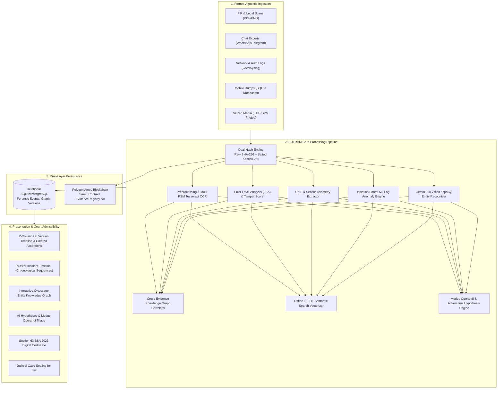
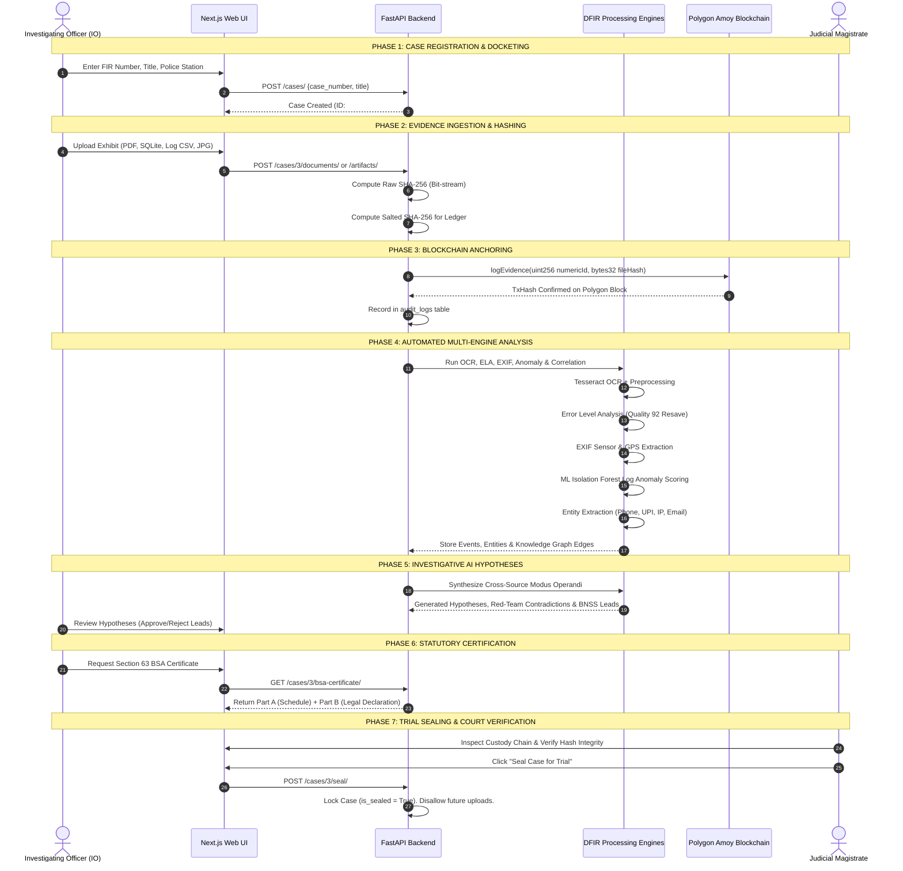
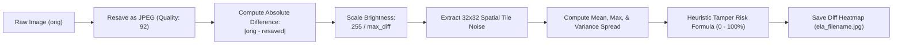
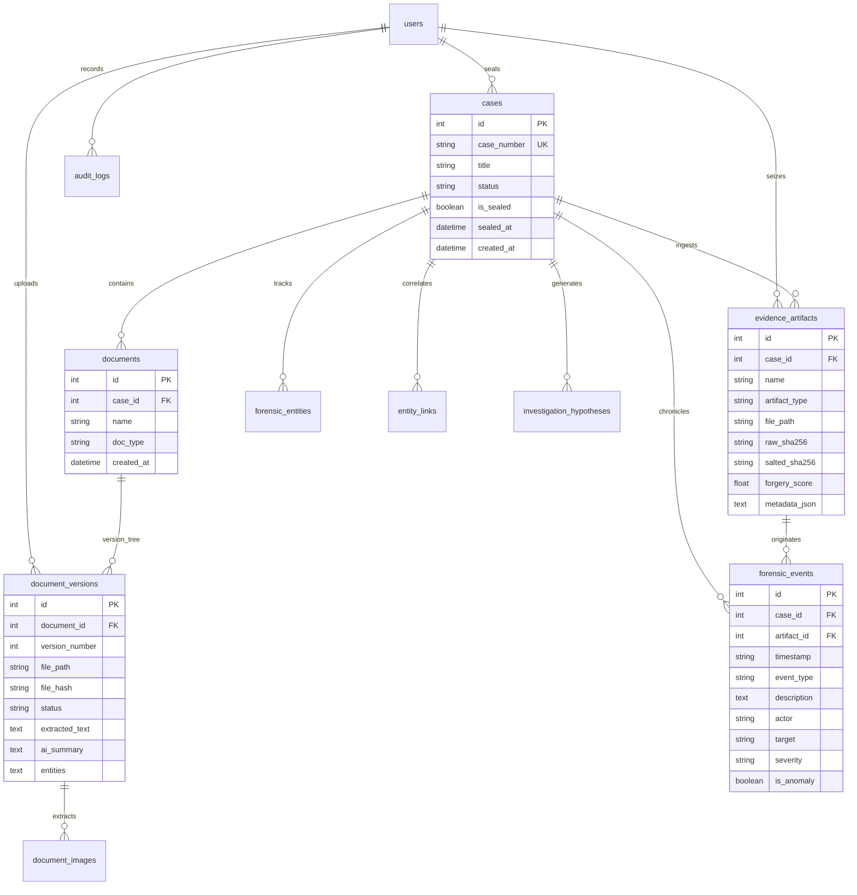

# SUTRAM 2026: Comprehensive System Architecture & Operational Workflow Specification

> **System Designation:** SUTRAM 2026 — Secure Unified Tamper-Resistant Artifact Management  
> **Statutory Alignment:** Bharatiya Sakshya Adhiniyam, 2023 (Section 63) & Bharatiya Nagarik Suraksha Sanhita, 2023 (BNSS Section 94)  
> **Ledger Technology:** Polygon Proof-of-Stake (Amoy Testnet — Chain ID: 80002)  
> **Core Paradigms:** Git-Inspired Immutable Versioning • Format-Agnostic Ingestion • Multi-Source DFIR Correlation • Explainable AI Reasoning

---

## 1. Executive Architecture Overview & System Philosophy

SUTRAM 2026 is an enterprise Digital Forensics & Incident Response (DFIR) and Blockchain Evidence Locker designed for law enforcement agencies, cybercrime investigation cells, forensic examiners, and judicial magistrates. It replaces fragile, disparate evidence storage with an immutable, verifiable, and AI-augmented chain of custody.



### Architectural Pillars:
1. **Dual-Hashing Cryptographic Integrity:** 
   - **Raw SHA-256:** Computed immediately on the raw bitstream upon acquisition for legal reproducibility in forensic labs.
   - **Salted Hash ($H_{\text{salted}} = \text{SHA-256}(\text{RawHash} \parallel \text{Salt})$):** Inscribed on the public Polygon blockchain, preventing rainbow-table pre-computation attacks while preserving complete public verifiability.
2. **Git-Inspired Version Control (No Hard Deletes):**
   - Documents and physical evidence maintain linear parent-child version lineages (`v1.0 Superseded` $\rightarrow$ `v2.0 Active`).
   - Every superseded file, forensic note, and officer metadata remains permanently indexed; deletion operations are physically prohibited in the schema.
3. **Format-Agnostic DFIR Ingestion:**
   - Unifies unstructured FIR PDFs, mobile extraction SQLite databases, firewall syslog CSVs, encrypted chat exports, and GPS photographs into a single correlated case dossier.

---

## 2. Role-Based Access Control Matrix (RBAC)

The system enforces strict separation of powers across law enforcement ranks:

| Capability / Action | Investigating Officer (`Officer`) | Supervisory Reviewer (`Reviewer`) | Judicial Magistrate (`Judge`) |
| :--- | :---: | :---: | :---: |
| **Default Persona** | Sub-Inspector Sharma (Badge: `9482A`) | Chief Inspector Verma (Badge: `1109X`) | Hon. Judge Patel (Badge: `JDG-01`) |
| **Case Docket Creation** | ✅ Allowed | ❌ Read-Only | ❌ Read-Only |
| **Document & Evidence Upload** | ✅ Allowed | ❌ Restricted | ❌ Restricted |
| **Version Update & Sealing** | ✅ Allowed | ❌ Restricted | ❌ Restricted |
| **DFIR Artifact Ingestion & Parsing** | ✅ Allowed | ❌ Restricted | ❌ Restricted |
| **Integrity Verification (Hash Check)** | ✅ Full Access | ✅ Full Access | ✅ Full Access |
| **Blockchain Polygonscan Audit** | ✅ Full Access | ✅ Full Access | ✅ Full Access |
| **AI Hypotheses Accept / Reject** | ✅ Investigator Review | ❌ Read-Only Review | ❌ Read-Only Review |
| **Download Section 63 BSA Certificate**| ✅ Allowed | ✅ Allowed | ✅ Allowed |
| **Permanent Judicial Case Sealing** | ❌ Forbidden | ❌ Forbidden | ✅ Exclusive Authority |

---

## 3. End-to-End Operational Lifecycle & Workflow



---

## 4. In-Depth Subsystem Technical Workflows

### 4.1 Ingestion & Dual-Layer Hashing Workflow
1. **Acquisition:** Files are received via `multipart/form-data` streams.
2. **Buffer Ingestion:** Read into memory as `bytes`.
3. **Standard Hash Computation:**
   $$\text{RawHash} = \text{SHA256}(\text{file\_bytes})$$
4. **Salted Blockchain Hash:**
   $$\text{SaltedHash} = \text{SHA256}(\text{RawHash} \parallel \text{SALT})$$
5. **Storage:** Stored in `uploads/` with a UUID prefix (`<uuid>_<original_name>`), preventing path traversal and name collision attacks.

---

### 4.2 OCR & Document Text Extraction Engine (`ocr_engine.py`)
1. **Detection:** Checks file magic bytes (`.pdf`, `.png`, `.jpg`, `.jpeg`).
2. **Preprocessing Pipeline:**
   - Flatten RGBA transparency to an RGB white canvas.
   - Grayscale conversion: $Y = 0.299R + 0.587G + 0.114B$.
   - Contrast Enhancement (1.5x) + Auto-deskew via bounding box moments.
3. **Multi-PSM OCR Execution:**
   - Pass 1: PSM 3 (Fully automatic page segmentation).
   - Pass 2: PSM 6 (Uniform block of text fallback).
   - Language Hint: `eng+hin` for mixed-script Indian FIRs.
4. **Post-Processing Filtering:** Strips OCR scan artifacts, symbol noise, and solitary non-alphanumeric characters.

---

### 4.3 Error Level Analysis (ELA) & Image Forgery Detection (`image_forgery.py`)
Detects spliced invoices, altered UPI screenshots, and forged bank transaction receipts:



#### Tamper Risk Calculation Formula:
$$\text{Score} = S_{\text{max}} + S_{\text{std}} + S_{\text{var}} + (2 \times \mu_{\text{error}})$$
Where:
- $S_{\text{max}} = 25$ if $\max(\text{diff}) > 45$ (JPEG compression delta)
- $S_{\text{std}} = 30$ if $\sigma_{\text{color}} > 6.0$ (High-frequency channel anomaly)
- $S_{\text{var}} = 35$ if $\sigma_{\text{tile\_variance}} > 50.0$ (Localized copy-move splicing)
- $\text{Tamper Score} = \min(\max(\text{Score}, 4.0), 98.0)$

---

### 4.4 EXIF & Sensor Telemetry Extraction (`metadata_forensics.py`)
1. **EXIF Interrogation:** Extracts Make, Model, Software, Lens, and DateTime tags.
2. **Software Signature Matching:** Flags editing signatures like `Photoshop`, `Canva`, `GIMP`, `Lightroom`, or `PicsArt`.
3. **GPS DMS to Decimal Conversion:**
   $$\text{Decimal} = \text{Degrees} + \frac{\text{Minutes}}{60} + \frac{\text{Seconds}}{3600}$$
   If GPS Reference is `'S'` or `'W'`, multiply by $-1$.
4. **Maps URL Synthesis:** Synthesizes `https://www.google.com/maps?q={lat},{lon}` for immediate satellite reconnaissance.

---

### 4.5 Machine Learning Log Anomaly Detection (`log_anomaly.py`)
Uses an **Unsupervised Isolation Forest** model on normalized event logs:
1. **Feature Engineering Matrix:**
   - $f_1$: Hour of day normalized ($\frac{\text{hour}}{24.0}$)
   - $f_2$: Off-hours indicator ($1.0$ if $23 \le \text{hour} \le 5$, else $0.0$)
   - $f_3$: Severity weight ($3.0$ for `CRITICAL`, $1.5$ for `WARNING`, $0.0$ for `INFO`)
   - $f_4$: Suspicious keyword trigger (`401`, `403`, `failed`, `admin`, `exploit`, `/etc/passwd`)
2. **Isolation Forest Hyperparameters:**
   - Contamination Rate: $\alpha = \min(\max(\frac{5.0}{N}, 0.05), 0.20)$
   - Output: Predictions $-1$ (Anomaly) vs $1$ (Normal) with anomaly score $-s(x)$.

---

### 4.6 Cross-Evidence Knowledge Graph Correlator (`correlation_engine.py`)
1. **Forensic Entity Regex Patterns:**
   - **Indian Phone:** `(?:(?:\+91|0)[-.\s]?)?[6-9]\d{9}`
   - **UPI VPA:** `[a-zA-Z0-9.\-_]{2,64}@[a-zA-Z]{2,32}`
   - **IPv4 Address:** `\b(?:(?:25[0-5]|2[0-4][0-9]|[01]?[0-9][0-9]?)\.){3}(?:25[0-5]|2[0-4][0-9]|[01]?[0-9][0-9]?)\b`
   - **Email:** `[a-zA-Z0-9_.+-]+@[a-zA-Z0-9-]+\.[a-zA-Z0-9-.]+`
   - **Crypto Wallet:** `0x[a-fA-F0-9]{40}` (Ethereum/Polygon) & Base58 (Bitcoin)
2. **Edge Generation:** Connects entities co-occurring in the same case into Cytoscape.js visual graph topologies with confidence weights.

---

### 4.7 Offline Semantic Vector Search (`vector_search.py`)
1. **Algorithm:** Sublinear Term Frequency - Inverse Document Frequency ($\text{TF-IDF}$) + Cosine Similarity.
2. **Parameters:**
   - N-Gram Range: $(1, 2)$ (unigrams + bigrams)
   - Max Features: $20,000$ vocabulary entries
   - Sublinear TF: $\text{tf}_{\text{sub}} = 1 + \log(\text{tf})$
   - Strip Accents: Unicode normalization
3. **Similarity Querying:**
   $$\text{Cosine Similarity} = \frac{\mathbf{q} \cdot \mathbf{d}}{\|\mathbf{q}\| \|\mathbf{d}\|}$$
   Returns ranked matching document chunks with exact score percentages.

---

### 4.8 Investigative AI & Modus Operandi Synthesis (`investigative_ai.py`)
Provides automated cross-examination and red-teaming:
- **Modus Operandi Breakdown:** Synthesizes attack vectors across multiple sources.
- **Devil's Advocate Challenges:** Counter-arguments to prevent confirmation bias.
- **Evidentiary Contradictions:** Flags physical impossibilities (e.g. login from two distant cities within 4 minutes).
- **Statutory Recommendations:** Auto-generates formal notices under **Section 94 of BNSS** to freeze bank accounts or seize IPDR/CDR logs.

---

### 4.9 Statutory Certification under Section 63 BSA 2023 (`bsa_certificate.py`)
Implements India's mandatory electronic evidence admissibility standards:
- **Part A (Schedule of Electronic Records):**
  - Itemized Exhibit Identifiers (`EXHIBIT-1` to `EXHIBIT-N`)
  - File Names, MIME types, and exact byte counts
  - Raw un-salted SHA-256 Bitstream Fingerprints
  - Polygon Amoy Blockchain Anchored Hashes
  - Source Device & Extraction Tooling Particulars
- **Part B (Statutory Declaration by Examiner):**
  - Sworn legal statement under Section 63 of Bharatiya Sakshya Adhiniyam, 2023 certifying system health, uncorrupted electronic storage, instantaneous cryptographic hashing, and chain-of-custody preservation.

---

### 4.10 Blockchain Smart Contract Registry (`EvidenceRegistry.sol`)
Deployed to Polygon Amoy Testnet (Chain ID 80002):
- **Contract Address:** `0x8784D3f0161a3bA1941942748041583b22CE286E`
- **Gas Optimization Technique:**
  - Uses `mapping(uint256 => bytes32) public evidenceHashes`.
  - Takes exactly **1 EVM storage slot** (20,000 gas initial write).
  - Emits `EvidenceLogged(uint256 indexed id, bytes32 fileHash, address indexed loggedBy)`.
  - Verification is a zero-gas `view` function: `verifyEvidence(uint256 _id, bytes32 _fileHash) returns (bool)`.

---

## 5. Relational Database Schema & Data Models



---

## 6. Complete REST API Endpoint Specification

### Core Case & Document APIs
- `GET /cases/` — List all active and sealed cases with document summaries.
- `POST /cases/` — Register new criminal case docket.
- `GET /cases/{id}` — Fetch detailed case docket, document versions, and sealer info.
- `POST /cases/{id}/documents/` — Upload & cryptographically seal initial document version.
- `POST /documents/{id}/versions/` — Append new version to linear Git-style document history.
- `GET /documents/{id}/verify/` — Compute live SHA-256 and cross-verify with database and blockchain.
- `POST /cases/{id}/seal/` — **Judicial Action:** Permanently lock case against future modifications.
- `GET /cases/{id}/report/` — Export complete court-ready Chain of Custody PDF/HTML dossier.

### DFIR & Multi-Source Forensics APIs
- `POST /cases/{id}/artifacts/` — Ingest raw forensic artifact (PCAP, SQLite, Syslog, Chat TXT).
- `GET /cases/{id}/artifacts/` — Retrieve all multi-source forensic exhibits for a case.
- `POST /cases/{id}/seed-sample-evidence/` — 1-Click ingestion of the 5 standard DFIR sample exhibits.
- `GET /artifacts/{id}/forgery/` — Fetch Error Level Analysis differential heatmap and ELA metrics.
- `GET /cases/{id}/timeline/` — Retrieve unified chronologically normalized incident timeline.
- `GET /cases/{id}/graph/` — Retrieve Cytoscape node-and-edge entity knowledge graph.
- `GET /cases/{id}/hypotheses/` — Retrieve AI-generated Modus Operandi and adversarial hypotheses.
- `POST /cases/{id}/hypotheses/generate/` — Trigger cross-evidence investigative hypothesis reasoning.
- `POST /hypotheses/{id}/review/` — IO triage action (Accept, Reject, or Flag hypothesis).
- `GET /cases/{id}/bsa-certificate/` — Generate Section 63 BSA 2023 Statutory Admissibility Certificate.

### Search & Vector APIs
- `GET /search/?q={query}` — Perform TF-IDF semantic vector search with cosine similarity ranking.
- `POST /search/backfill/` — Rebuild and serialize vector search index for offline execution.
- `GET /search/status/` — Inspect indexed document count and vocabulary size.

---

## 7. Frontend User Experience & UI Component Hierarchy

The application runs on Next.js 16 (App Router + Turbopack) styled with Tailwind CSS and Lucide icons:

```
frontend/src/
├── app/
│   ├── layout.tsx              # Root HTML shell & global font definitions
│   ├── page.tsx                # Main Dashboard (Cases table, Quick Stats, Global Search)
│   ├── login/page.tsx          # RBAC Authentication Switcher (Officer, Reviewer, Judge)
│   ├── audit/page.tsx          # Immutable Audit Trail & Polygon Transaction Explorer
│   ├── case/[id]/page.tsx      # Case Dossier (4 Workflow Tabs & 2-Column Custody View)
│   └── document/[id]/page.tsx  # Document Version History & Version Append Interface
├── components/
│   ├── Navbar.tsx              # Global navigation bar with Role Pill & Verification status
│   ├── MasterTimeline.tsx      # Chronological multi-source incident timeline
│   ├── EvidenceGraph.tsx       # Cytoscape.js interactive entity knowledge graph
│   ├── BSACertificateModal.tsx # Statutory Section 63 BSA 2023 Certificate Modal
│   ├── ForgeryModal.tsx        # Image Tamper Detection Lab (ELA heatmaps & EXIF viewer)
│   └── ExhibitIntakeModal.tsx  # Multi-format forensic file uploader
```

### Case Details 4-Tab Workspace (`case/[id]/page.tsx`):
1. **Document Chain of Custody (Tab 1):**
   - **Left Column (4 Cols):** Case summary card (FIR number, status, download buttons, BSA certificate trigger, Quick Seed DFIR button) + Add New Document form with dynamic context fields.
   - **Right Column (8 Cols):** Git-inspired version tree with glowing green active nodes, superseded grey audit nodes, officer badge pills, raw SHA-256 monospace hash boxes, and 3 colored collapsible accordions:
     - 🟢 **AI Document Analysis** (Auto-Generated executive summary + entity chips)
     - 🟣 **AI OCR Scan — Extracted Text** (Monospace extracted text + word count)
     - 🟡 **Extracted Images & Photos** (Thumbnails, ELA tamper heatmap, and GPS map link)
2. **Master Incident Timeline (Tab 2):** Unified chronological event stream connecting firewall bursts, chat messages, and mobile extractions.
3. **Entity Knowledge Graph (Tab 3):** Node-and-edge visual graph clustering suspects, phones, UPI accounts, and IPs.
4. **AI Hypotheses & Triage (Tab 4):** Root-cause Modus Operandi breakdown, adversarial counter-arguments, contradiction detection, and IO action buttons.

---

## 8. Deployment & Execution Runbooks

To guarantee zero-setup execution on Windows environments, the repository includes hardened launcher scripts:

### Quick Launch Commands:
- **Start All Services:** Double-click `run.bat` (located at root `C:\My Projects\SUTRAM 2026\run.bat` or `Prototype\run.bat`).
- **Stop All Services:** Double-click `stop.bat` or press `Q` in the launcher menu.

### Automated Launcher Operations in `run.bat`:
1. **Python Path Auto-Detection:** Automatically scans for Python 3.11+ at `%LOCALAPPDATA%\Python\pythoncore-3.14-64\python.exe` and standard directories without requiring manual Windows PATH editing.
2. **Port Conflict Clearance:** Scans `netstat` and terminates lingering zombie processes on ports `8000` (FastAPI) and `3000` (Next.js).
3. **Server Readiness Polling:** Continuously polls `http://127.0.0.1:8000/docs` and `http://localhost:3000` until both are active before firing requests.
4. **Automated DFIR Seeding:** Automatically executes POST requests to `/setup-dummy-data/`, `/search/backfill/`, and `/cases/3/seed-sample-evidence/`.
5. **Browser Auto-Launch:** Opens default browser directly to `http://localhost:3000/case/3`.
6. **Interactive CLI Dashboard:** Provides 1-key shortcuts (`1` for Dashboard, `2` for Case 3, `3` for Swagger Docs, `4` for Re-seeding exhibits, `Q` for Clean Shutdown).
